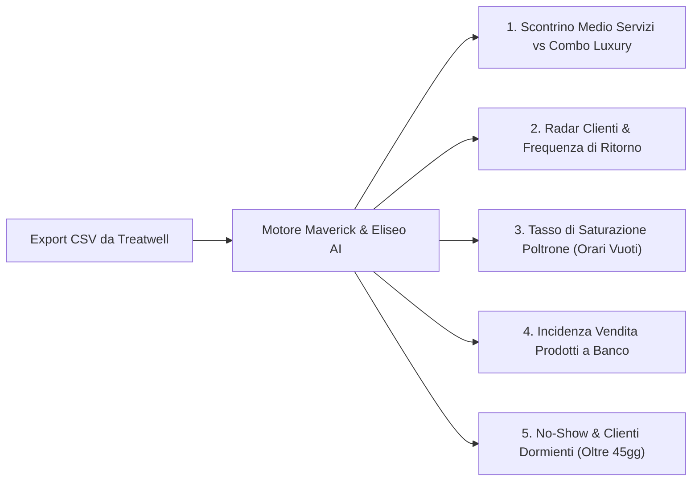

# GUIDA OPERATIVA: DIMOSTRAZIONE MAVERICK ED ELISEO AI PER MAURIZIO
### Analisi strategica dei dati reali della barberia tramite esportazione KPI di Treatwell

Questo documento è la traccia pronta per guidare la presentazione a Maurizio di **Maverick** ed **Eliseo AI**, dimostrando sul campo come trasformare i dati esportati da Treatwell in decisioni strategiche per **Maurizio Barber Shop** e **Barber Reset**.

---

## 1. COME ACCEDERE AGLI STRUMENTI NEL PORTALE

Sia Maverick che Eliseo AI sono integrati direttamente nell'Area Riservata del sito:
- **Indirizzo**: `https://maximize-academy.vercel.app/area` (oppure in locale su `http://localhost:5173/area`)
- **Accesso**: con le credenziali riservate di Maurizio ed Eliseo (già sincronizzate con il database Supabase).
- Nella barra strumenti interna troverai i tre pannelli:
  - 🤖 **Maverick**: il copilota di business, radar clienti, simulatore e calcolo KPI.
  - 🧠 **Eliseo AI**: il motore di intelligenza artificiale per l'assistenza, le regole e la gestione richieste.
  - 👥 **Eliseo CRM**: la rubrica strategica per il controllo dei contatti e delle campagne di riattivazione.

---

## 2. COME CARICARE I DATI ESPORTATI DA TREATWELL

Dalla dashboard gestionale di **Treatwell Connect** di Maurizio Barber Shop:
1. Vai su **Report > Esporta Dati** (oppure **Clienti > Esporta CSV**).
2. Scarica i report in formato standard:
   - *Report Appuntamenti & Servizi*: data, servizio erogato, prezzo, operatore.
   - *Report Clienti*: anagrafica, data ultimo taglio, numero totale visite.
3. In **Eliseo CRM / Maverick**, seleziona **Importa CSV**: i dati vengono normalizzati e analizzati all'istante senza inviare informazioni riservate a server terzi non autorizzati.

---

## 3. I 5 KPI CHIAVE CHE MAVERICK ED ELISEO AI ANALIZZANO AUTOMATICAMENTE

### 1. Scontrino Medio Servizi vs Combo & Luxury
- *Cosa misura*: Il ricavo medio generato per ciascun cliente che si siede in poltrona.
- *Analisi AI*: Separa chi fa solo taglio da chi sceglie il pacchetto completo Taglio + Rituale Barba. Se lo scontrino medio scende sotto la soglia ideale (es. 25-28 €), Maverick suggerisce le leve per proporre il panno caldo e i prodotti della linea retail.

### 2. Radar Clienti e Frequenza di Ritorno (Retention Rate)
- *Cosa misura*: Quanti giorni passano mediamente tra una seduta e la successiva.
- *Analisi AI*: Un cliente con sfumatura a pelle che torna ogni 21 giorni vale il doppio di chi torna ogni 45 giorni. Maverick raggruppa i clienti in:
  - *Fedeli Attivi*: tornano ogni 14-25 giorni.
  - *In ritardo*: oltre 35 giorni dall'ultimo servizio.
  - *Dormienti a rischio abbandono*: oltre 45 giorni senza prenotazione.

### 3. Tasso di Saturazione Oraria delle Poltrone
- *Cosa misura*: Le fasce orarie in cui il salone ha buchi d'agenda (es. martedì e mercoledì mattina).
- *Suggerimento Strategico*: Maverick ed Eliseo AI formulano proposte di campagne WhatsApp mirate per riempire gli slot deboli con promozioni speciali riservate ai clienti flessibili (pensionati, studenti, liberi professionisti).

### 4. Tasso di Attaccamento Prodotti (Retail Attachment Rate)
- *Cosa misura*: Quanti scontrini su 100 contengono anche l'acquisto di un prodotto a casa (cera, olio barba ANAQA, shampoo).
- *Valore Barber Reset*: Portare l'attachment rate dal 5% al 20% aumenta il fatturato netto a fine mese senza dover allungare gli orari di lavoro dei barbieri.

### 5. Azione Automatica: Messaggi WhatsApp di Recupero "Un-Click"
- Per ogni cliente segnalato come "Dormiente" da Treatwell, Eliseo AI genera all'istante il testo del messaggio WhatsApp personalizzato (amichevole, elegante e con il link per riprenotare), pronto per essere inviato con un tocco.

---

## 4. LA SCALETTA DELLA DIMOSTRAZIONE PER MAURIZIO (15 Minuti)

1. **Minuti 0 - 3: Introduzione e Visione**  
   Mostrare a Maurizio come il sistema si integra con la nostra filosofia: non vogliamo sostituire Treatwell (che resta l'agenda per il cliente finale), ma vogliamo **dare un cervello analitico ai dati di Treatwell** per far guadagnare di più il salone.
2. **Minuti 3 - 7: Demo del Pannello Maverick**  
   Aprire la sezione *Crescita & KPI*, mostrare la simulazione dei ricavi all'aumentare di 2€ dello scontrino medio o all'aumento delle combo barba.
3. **Minuti 7 - 12: Demo di Eliseo AI & CRM**  
   Mostrare come l'AI analizza la lista dei clienti, individua chi non viene da oltre un mese e scrive il messaggio perfetto per farlo tornare in poltrona.
4. **Minuti 12 - 15: Connessione con Barber Reset & M×E Barber Lab**  
   Concludere dimostrando che questo stesso strumento non serve solo per Maurizio Barber Shop, ma diventa il servizio di punta da vendere agli altri saloni clienti di M×E Barber Lab!

