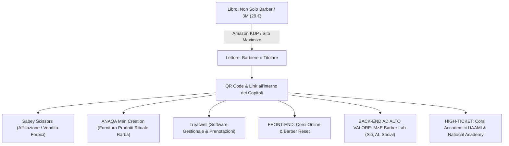

# PIANO STRATEGICO EDITORIALE & MESSAGGIO PER MAURIZIO
**Progetto Libro Ufficiale: Ecosistema Maximize Academy & M×E Barber Lab**
*Autori: Maurizio Pizzuto & Eliseo Miraglia*

---

## 1. INTRODUZIONE & ANALISI DELL'OPPORTUNITÀ

La proposta di Maurizio è un colpo da maestro strategico ed economico.
I PDF acquistati del corso *Praxia – Metodo Sfumatura Perfetta* contengono un'ottima base anatomico-meccanica (forme del cranio, geometrie delle sfumature, 12 tagli, schede base), ma sono:
1. **Anonimi e freddi**: privi di carisma, di filosofia e di identità di brand.
2. **Limitati al solo taglio**: ignorano l'imprenditoria, la customer experience d'élite, la digitalizzazione e l'AI.
3. **Privi di un ecosistema di vendita**: non hanno un back-end formativo o commerciale.

Trasformare questo materiale grezzo in un'opera proprietaria Maximize Academy significa creare il **primo manuale ibrido per barber in Italia** che unisce:
- **Tecnica chirurgica e precisione da palco** (l'esperienza e l'autorevolezza di Maurizio Pizzuto).
- **Esperienza cliente e rituali d'eccellenza** (standard di salone, forbici Sabey, rituale barba ANAQA).
- **Marketing digitale, contenuti virali e Intelligenza Artificiale** (la visione e i sistemi tecnologici di Eliseo Miraglia con M×E Barber Lab).

---

## 2. STUDIO DEL TITOLO: EVOLUZIONE DEL CONCEPT "LE 3M PER E"

L'idea di Maurizio ("Le 3M per E") è un concept affascinante che racchiude il legame tra:
- **M**aurizio Pizzuto
- **M**aximize Academy
- **M**×E Barber Lab
- per **E**liseo (e per l'**E**voluzione / l'**E**ccellenza del barbiere)

Per il mercato editoriale di Amazon KDP e per la vendita diretta sul sito a **29 €**, il titolo deve avere sia una forte carica identitaria, sia un sottotitolo orientato al beneficio diretto del lettore (search intent, conversione, valore percepito).

Ecco le **4 opzioni di naming strategico** formulate per Maurizio:

### OPZIONE A (La più forte, bilancia brand e mercato):
> **NON SOLO BARBER: IL METODO 3M**
> *Dalla Tecnica Millimetrica all'Impresa Digitale: Sfumature, Rituali, Social Media e AI per il Barbiere del Futuro.*
> *Di Maurizio Pizzuto & Eliseo Miraglia (Maximize Academy × M×E Barber Lab)*

### OPZIONE B (Focalizzata sul concept originale di Maurizio):
> **LE 3M PER E: L’Evoluzione del Barbiere Moderno**
> *Mente, Metodo, Mercato: Come Dominare la Sedia, Raddoppiare il Valore del Servizio e Costruire un Brand Digitale.*

### OPZIONE C (Focalizzata sull'autorevolezza accademica e tecnica):
> **MAXIMIZE: IL MANUALE DEFINITIVO DEL BARBIERATO**
> *Anatomia del Taglio, Geometria della Sfumatura, Cura della Barba e Strategia Digitale M×E.*

### OPZIONE D (Focalizzata sul riscatto economico e di carriera):
> **IL BARBIERE SCALABILE**
> *Dal Taglio a 15€ al Salone da 10K/Mese: Il Metodo Maximize Academy & M×E Barber Lab per eccellere tecnicamente e farsi scegliere online.*

---

## 3. MODELLO DI BUSINESS & FUNNEL COMMERCIALE (29 € E OLTRE)

Il libro a **29 €** non è solo una fonte di cassa diretta (margine netto sia su Amazon KDP che su vendita diretta PDF/ePub con Stripe su Maximize Academy), ma è il **miglior strumento di acquisizione clienti (Tripwire/Lead Magnet ad alto valore)** per l'intero ecosistema.

### Le 4 sorgenti di monetizzazione del libro:
1. **Vendita Diretta (29 €)**:
   - Su Amazon KDP (formato copertina flessibile e Kindle eBook).
   - Su sito Maximize Academy (checkout Stripe, consegna automatica PDF interattivo + checklist stampabili).
2. **Promozione Strumenti & Partner Ufficiali**:
   - Capitoli dedicati all'uso delle forbici Sabey, dei prodotti rituali ANAQA e dell'agenda Treatwell con link/QR code dedicati.
3. **Candidature a Barber Reset & Masterclass Maximize**:
   - Il libro dimostra l'eccellenza metodologica e invita i titolari di salone a richiedere la consulenza Barber Reset per ottimizzare listini e margini.
4. **Acquisizione Clienti per M×E Barber Lab**:
   - I capitoli su Social, Video e AI posizionano M×E Barber Lab come l'agenzia d'eccellenza per la digitalizzazione delle barberie italiane.

---

## 4. ARCHITETTURA DELL'OPERA (I 6 MODULI DEFINITIVI)

L'opera è organizzata in **6 Moduli logici e 18 Capitoli**, per un totale di circa 150-180 pagine di pura sostanza, senza "aria fritta":

1. **MODULO 1: LA MENTALITÀ & L'ECOSISTEMA (Non Solo Barber. Molto di Più)**
   - *Cap. 1*: Dalla Sedia all'Impresa — Perché saper tagliare non basta più.
   - *Cap. 2*: Il Metodo Maximize: Standard igienici, rituale d'accoglienza e valore percepito.
   - *Cap. 3*: L'Arsenale del Maestro: Macchinette, lame, forbici Sabey ed ergonomia posturale.
2. **MODULO 2: LA SCIENZA CRANICA E LA GEOMETRIA DELLA SFUMATURA**
   - *Cap. 4*: La Diagnosi Morfologica in 60 Secondi (Cranio, lineamenti, vortici).
   - *Cap. 5*: La Geometria del Fade (Low, Mid, High, Taper, Drop, Burst Fade).
   - *Cap. 6*: Il Protocollo Zero-Ombra: La tecnica a ventaglio (Scoop) e cancellazione linee.
   - *Cap. 7*: I 10 Errori Letali del Fade e la Guida di Pronto Soccorso in Poltrona.
3. **MODULO 3: I 12 TAGLI ICONICI & L'ARTE DEL FREESTYLE**
   - *Cap. 8*: Il Catalogo dei 12 Tagli più Richiesti nel Salone Moderno (Schede millimetriche passo-passo).
   - *Cap. 9*: Freestyle & Hair Tattoo: Geometrie, linee nitide e micro-dettagli.
4. **MODULO 4: IL RITUALE BARBA E LA CONSULENZA STRATEGICA**
   - *Cap. 10*: Architettura e Morfologia della Barba.
   - *Cap. 11*: Il Rituale Barba ANAQA in 5 Step (Panno caldo, preparazione, rasatura, ozono, post-rasatura).
   - *Cap. 12*: La Consulenza Strategica in Poltrona: Le 4 Domande d'Oro per alzare lo scontrino medio.
5. **MODULO 5: L'ALLENAMENTO DEI 21 GIORNI & OPERATIVITÀ IN SALONE**
   - *Cap. 13*: Il Programma dei 21 Giorni Maximize Academy (Da zero a velocità da salone).
   - *Cap. 14*: Il Kit Operativo: Procedure d'apertura, scheda cliente, gestione magazzino.
6. **MODULO 6: M×E BARBER LAB — IL DIGITALE, I SOCIAL E L'INTELLIGENZA ARTIFICIALE**
   - *Cap. 15*: Foto e Video da Smartphone che Vendono: Luci, inquadrature e montaggio reel.
   - *Cap. 16*: Il Metodo M×E per Instagram & TikTok: Come attirare clienti nella propria città.
   - *Cap. 17*: L'Intelligenza Artificiale per Barbieri: 20 Prompt pronti per post, recensioni e marketing.
   - *Cap. 18*: Da Barbiere a Brand: La scalata verso Barber Reset e la National Academy.

---

## 5. MESSAGGIO PRONTO DA INVIARE A MAURIZIO (WHATSAPP / VOCALE)

*Questo è il messaggio perfetto, empatico, professionale ed entusiasta che Eliseo può inviare direttamente a Maurizio:*

---

> Ciao Maurizio! 💪🔥
> 
> Ho analizzato nel dettaglio tutti i PDF di Praxia che mi hai inviato.
> La tua intuizione è formidabile: il materiale acquistato ha una buona base tecnica (forme craniche, geometrie della sfumatura, i 12 tagli e le schede operative), ma è completamente privo di anima, di brand e di visione commerciale. È il classico corso "meccanico".
> 
> Trasformarlo nel nostro **primo vero libro ufficiale firmato da noi** è la mossa perfetta per consacrare Maximize Academy e M×E Barber Lab a livello nazionale.
> 
> Ho adorato il tuo concept **“Le 3M per E”** (Maurizio, Maximize, M×E ed Eliseo)! Racchiude alla perfezione la nostra unione: **la tua maestria tecnica e la mia visione digitale e strategica.**
> 
> Per il titolo principale su Amazon e sul sito, ho elaborato 4 proposte pazzesche, tra cui questa che secondo me spacca il mercato:
> 
> 📖 **"NON SOLO BARBER: IL METODO 3M"**
> *Sottotitolo: Dalla Tecnica Millimetrica all’Impresa Digitale: Sfumature, Rituali, Social Media e AI per il Barbiere del Futuro.*
> *(Firmato: Maurizio Pizzuto ed Eliseo Miraglia)*
> 
> All'interno abbiamo una prefazione dedicata proprio al concept de *"Le 3M per E"* e alla nascita del nostro sodalizio!
> 
> La struttura che ho progettato non si limita a riscrivere i PDF, ma li eleva a livello di lusso:
> 1. **La Mentalità e gli Standard Maximize** (non siamo semplici esecutori, ma professionisti di valore).
> 2. **La Scienza Cranica e la Sfumatura Zero-Ombra** (tutta la tua precisione tecnica spiegata in modo chiaro e chirurgico).
> 3. **I 12 Tagli Iconici + Freestyle** (schede tecniche moderne per ogni cliente che entra in salone).
> 4. **Il Rituale Barba in 5 Step & La Consulenza** (con il focus sui panni caldi ANAQA e la tecnica per alzare lo scontrino medio).
> 5. **Il Programma di Addestramento 21 Giorni & Il Kit Operativo di Salone**.
> 6. **La Sezione M×E Barber Lab (Social, Video & Intelligenza Artificiale)**: smartphone photography, come creare reel che portano clienti in poltrona con Treatwell e 20 prompt AI pronti all'uso per non perdere tempo a scrivere post!
> 
> Prezzo di vendita a **29 €** sul nostro sito (con download istantaneo e modelli stampabili) e pubblicazione su **Amazon KDP** in versione cartacea e Kindle per posizionarci come massimi esperti del settore. Inoltre, all'interno del libro inseriremo i QR code e i richiami a **Barber Reset**, alle tue **Masterclass**, ai prodotti **ANAQA/Sabey** e ai servizi digitali di **M×E Barber Lab**.
> 
> Ho già iniziato a redigere l'intero manoscritto nei minimi dettagli. 
> Dimmi cosa ne pensi del titolo e della struttura: siamo pronti a fare la storia del settore barber in Italia! 🚀🚀

